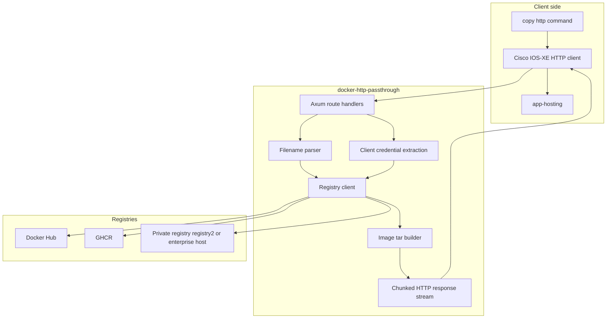
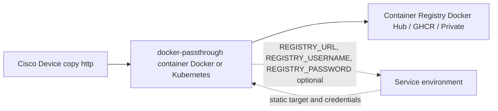
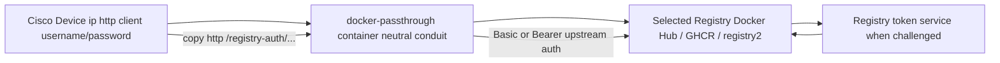
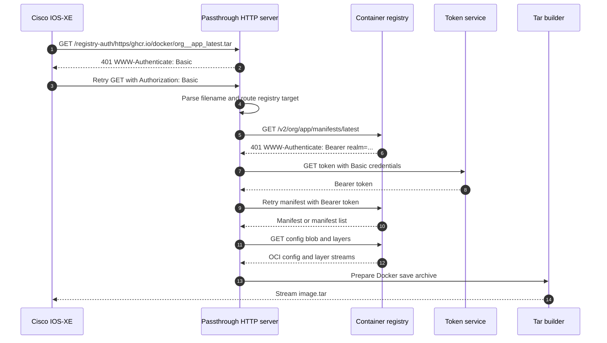
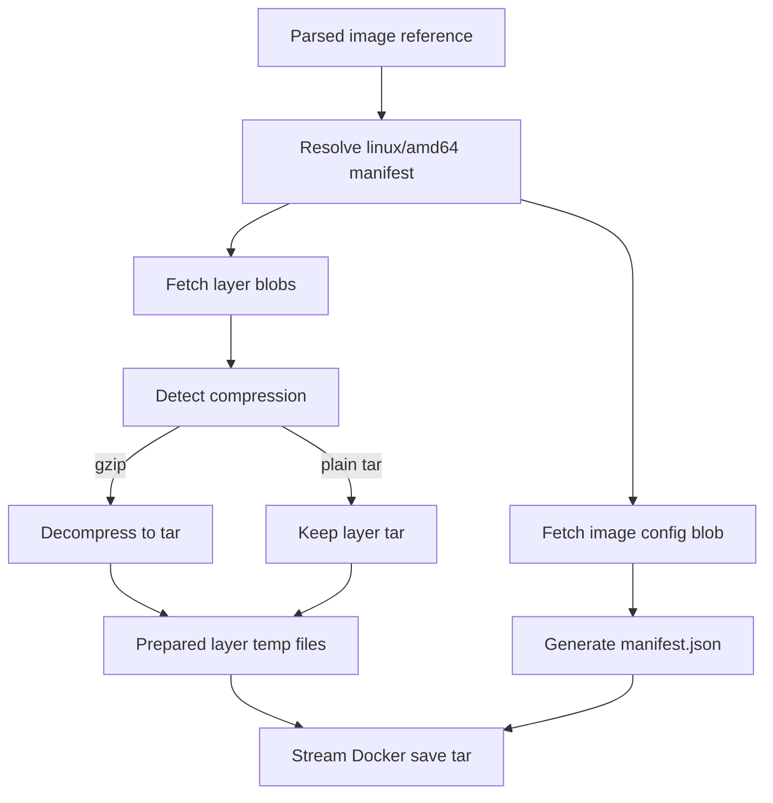

# Architecture

The service is intentionally small: an HTTP server, a registry client, and a tar builder. The HTTP layer parses requests and handles Cisco/client credentials. The registry layer speaks the OCI Distribution API. The tar builder prepares an archive that IOS-XE app-hosting can install.

## Component view

## Topology without client-supplied credentials

Use this mode when the passthrough service owner controls the registry destination and credentials.

## Topology with Cisco-supplied authentication

Use this mode when users do not control the passthrough container environment and need to provide all registry details from the Cisco CLI.

## Request lifecycle

## Tar preparation pipeline

The service prepares the image before committing a `200 OK` response so registry errors are returned as request failures instead of partial archives.
