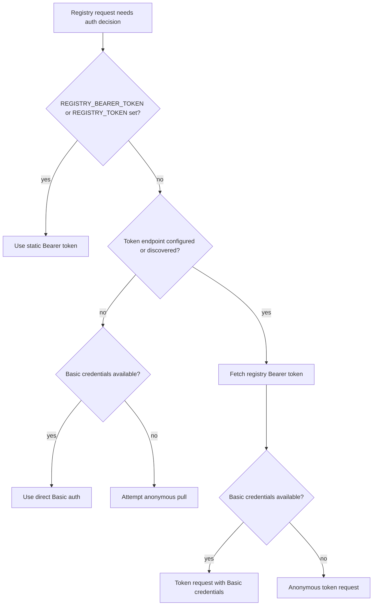
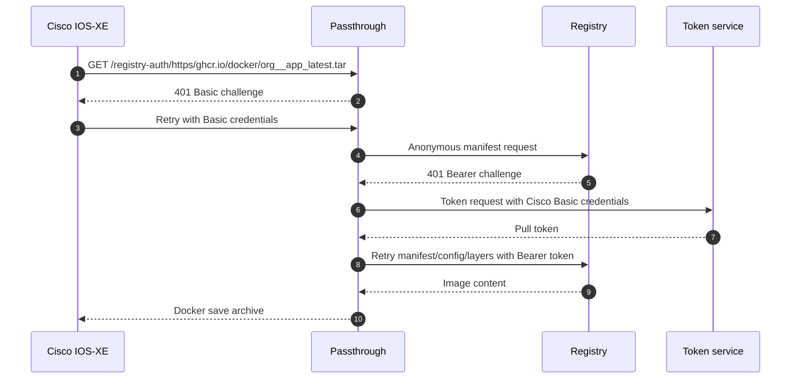
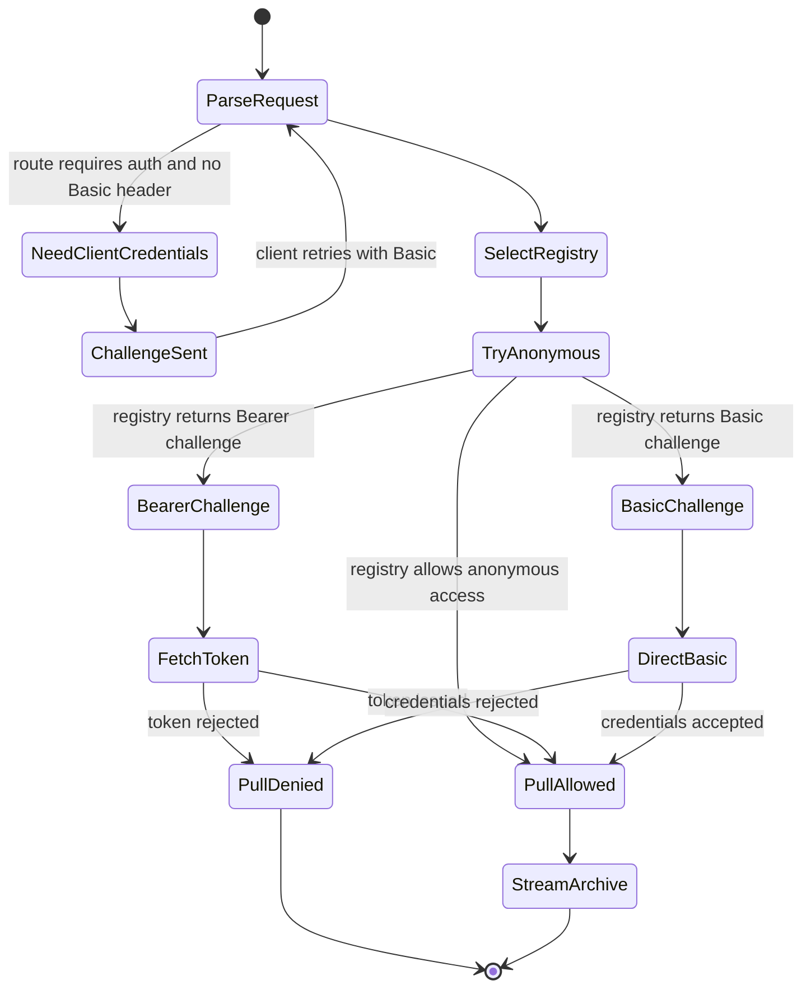

# Registry Authentication

Authentication has two sides:

- Client-to-passthrough: Cisco IOS-XE can supply Basic credentials with `ip http client username` and `ip http client password`.
- Passthrough-to-registry: the service uses anonymous access, Basic auth, static Bearer tokens, or registry-issued Bearer tokens.

## Credential sources



Credential precedence:

1. Static bearer token from `REGISTRY_BEARER_TOKEN` or `REGISTRY_TOKEN`
2. Token endpoint flow using client Basic credentials when supplied
3. Token endpoint flow using static `REGISTRY_USERNAME` and `REGISTRY_PASSWORD`
4. Direct Basic auth using client credentials when supplied
5. Direct Basic auth using static credentials
6. Anonymous pull

## Cisco-supplied credentials

The Cisco HTTP client can be configured globally:

```text
configure terminal
ip http client username <registry-username>
ip http client password <registry-password-or-token>
end
```

The passthrough service challenges with:

```text
HTTP/1.1 401 Unauthorized
WWW-Authenticate: Basic realm="registry credentials"
```

The Cisco device retries the request with a Basic `Authorization` header. The service uses those credentials only for the current upstream registry request or token exchange.

## `/registry-auth` challenge flow



## Auth state machine



## Neutral conduit mode

For the most neutral model, leave static credential variables unset and use `/registry-auth/...`:

```text
REGISTRY_USERNAME=
REGISTRY_PASSWORD=
REGISTRY_BEARER_TOKEN=
```

The Cisco CLI then supplies both registry identity and selected registry target:

```text
copy http://<passthrough-ip>:8080/registry-auth/https/ghcr.io/docker/my-org__private-image_latest.tar flash:ghcr-image.tar
```

Clean up client credentials when the transfer is finished:

```text
configure terminal
no ip http client username
no ip http client password
end
```
