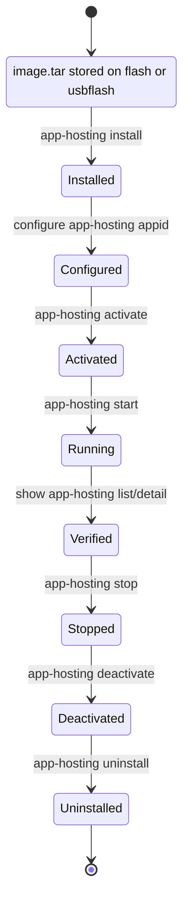
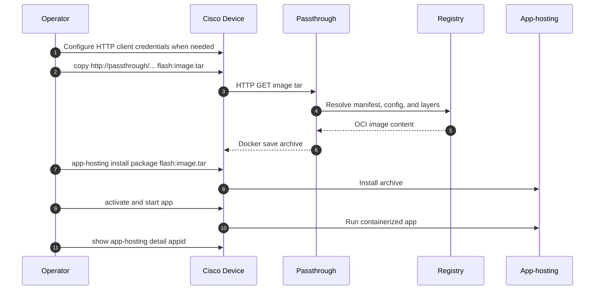

# Cisco IOS-XE Workflows

Cisco IOS-XE devices use the service with `copy http`, then install the returned Docker save archive with app-hosting.

## Public image copy

```text
copy http://10.20.30.40:8080/docker/nginx_latest.tar flash:nginx.tar
```

## Private registry copy with Cisco credentials

```text
configure terminal
ip http client username <registry-username>
ip http client password <registry-password-or-token>
end
copy http://10.20.30.40:8080/registry-auth/https/ghcr.io/docker/my-org__private-image_latest.tar flash:private-image.tar
```

## App-hosting lifecycle



## Install and start

```text
app-hosting install appid <appid> package flash:<image>.tar
configure terminal
app-hosting appid <appid>
 app-vnic AppGigabitEthernet trunk
  vlan <vlan-id> guest-interface 0
end
app-hosting activate appid <appid>
app-hosting start appid <appid>
show app-hosting list | include <appid>
show app-hosting detail appid <appid>
```

## Cisco workflow sequence



## Copy command patterns

| Scenario | Command shape |
|----------|---------------|
| Public Docker Hub | `copy http://<passthrough>:8080/docker/nginx_latest.tar flash:nginx.tar` |
| Public GHCR | `copy http://<passthrough>:8080/registry/https/ghcr.io/docker/owner__package_tag.tar flash:image.tar` |
| Private GHCR | `copy http://<passthrough>:8080/registry-auth/https/ghcr.io/docker/owner__package_tag.tar flash:image.tar` |
| Enterprise registry | `copy http://<passthrough>:8080/registry-auth/http/registry2.example.com:5000/docker/team__app_tag.tar flash:image.tar` |
| Published passthrough service image | `copy http://<passthrough>:8080/registry/https/ghcr.io/docker/cisco-open__docker-http-passthrough_latest.tar usbflash1:docker-http-passthrough.tar` |
