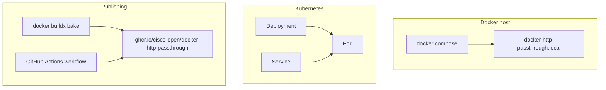
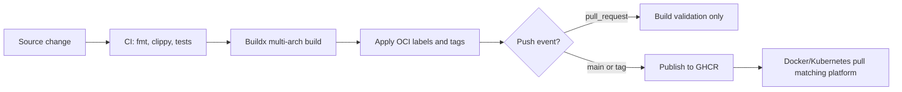

# Deployment

The service can run locally with Docker Compose, in Kubernetes, or from a published multi-arch OCI image.

## Docker Compose

```bash
docker compose up -d
curl http://localhost:8080/health
```

Key environment variables:

| Variable | Purpose |
|----------|---------|
| `REGISTRY_URL` | Default registry V2 API URL |
| `REGISTRY_NAME` | Registry display name |
| `REGISTRY_AUTH_URL` | Token endpoint for static default registry |
| `REGISTRY_SERVICE` | Token service value |
| `REGISTRY_USERNAME` | Static registry username |
| `REGISTRY_PASSWORD` | Static registry password or token |
| `REGISTRY_BEARER_TOKEN` | Static ready-to-use Bearer token |
| `REGISTRY_CLIENT_AUTH` | `optional`, `required`, or `off` |
| `REGISTRY_DEFAULT_NAMESPACE` | Optional namespace for single-component image names |
| `OTEL_EXPORTER_OTLP_ENDPOINT` | OTLP gRPC collector endpoint |

## Kubernetes

Apply the included manifest:

```bash
kubectl apply -f kubernetes.yaml
```

The manifest creates:

- Namespace
- Deployment
- Service
- Liveness and readiness probes

## Deployment topology



## OCI image publishing

The repository includes:

- `Dockerfile`
- `docker-bake.hcl`
- `.github/workflows/container-image.yml`
- `.dockerignore`

The publishing workflow builds `linux/amd64` and `linux/arm64` images and publishes a single manifest list to:

```text
ghcr.io/cisco-open/docker-http-passthrough:<tag>
```

## Publish flow



## Build commands

```bash
docker buildx bake image-local
docker buildx bake image-all
IMAGE=ghcr.io/cisco-open/docker-http-passthrough TAG=latest docker buildx bake image-push
```
