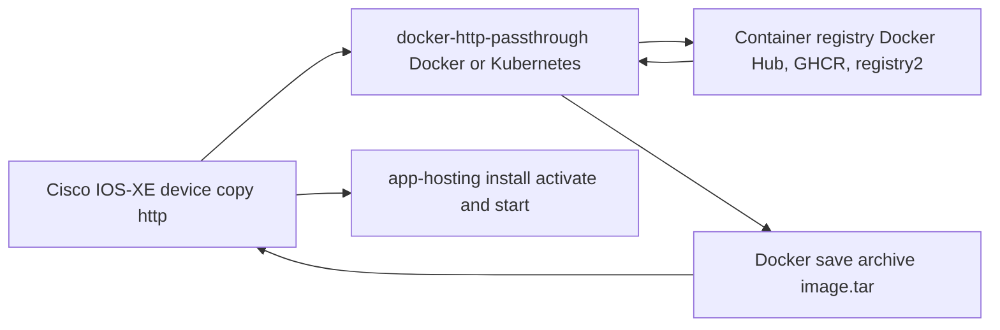

# Docker HTTP Passthrough

Docker HTTP Passthrough is a registry-aware HTTP service that converts OCI/Docker registry images into Docker save-compatible tar archives. It is designed for Cisco IOS-XE app-hosting workflows where a device retrieves an image with `copy http`, stores the archive locally, and then installs it with `app-hosting`.

The passthrough service does not pull images through a local Docker daemon. It talks directly to the registry V2 API, prepares the image config and layer tar files, and streams a Docker save archive to the requesting client.

## What the service solves

Network devices often have a simple HTTP file-transfer workflow, while modern container images live in OCI registries. This service bridges that gap:

- Cisco device uses `copy http://... flash:image.tar`
- Passthrough service retrieves the requested image from Docker Hub, GHCR, or a private registry
- Service prepares a Docker save archive
- Cisco device installs and starts the archive with app-hosting

## Primary capabilities

| Capability | Summary |
|------------|---------|
| Default registry route | `/docker/{filename}` uses registry settings from environment variables |
| Request-selected registry | `/registry/{scheme}/{host}/docker/{filename}` lets the client select Docker Hub, GHCR, or an enterprise registry |
| Client-supplied credentials | `/registry-auth/{scheme}/{host}/docker/{filename}` challenges the Cisco HTTP client and forwards Basic credentials upstream |
| Registry token exchange | Supports Docker Hub and Bearer challenge token services |
| Direct Basic auth | Supports registries that expect Basic credentials directly |
| Docker save archive | Produces tar archives compatible with Docker load and IOS-XE app-hosting install workflows |
| OpenTelemetry tracing | Emits parent/child spans for request parsing, authentication, registry calls, tar preparation, and streaming |
| Multi-arch service image | Provides artifacts to build and publish the passthrough service as a `linux/amd64` and `linux/arm64` OCI image |

## End-to-end flow

## Documentation map

- [Architecture](architecture.md): components, request flow, tar preparation, and topology
- [Routes and Filenames](routes.md): endpoint syntax and filename encoding rules
- [Registry Authentication](authentication.md): static credentials, Cisco-supplied credentials, Basic auth, and Bearer challenge handling
- [Cisco IOS-XE Workflows](cisco-ios-xe.md): copy command patterns and app-hosting lifecycle
- [Registry Support](registry-support.md): Docker Hub, GHCR, and enterprise registry behavior
- [OpenTelemetry](observability.md): trace hierarchy and semantic attributes
- [Deployment](deployment.md): Docker Compose, Kubernetes, and GHCR publishing
- [Validation](validation.md): test matrix and release-readiness checks
- [Security](security.md): credential handling and deployment controls
- [Licensing](licensing.md): project license and third-party notices
