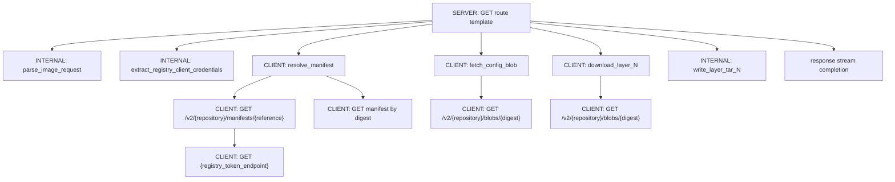
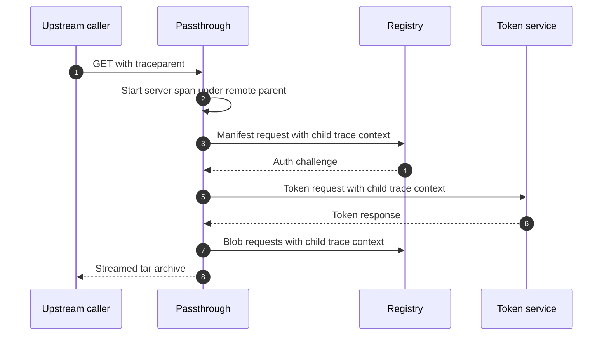
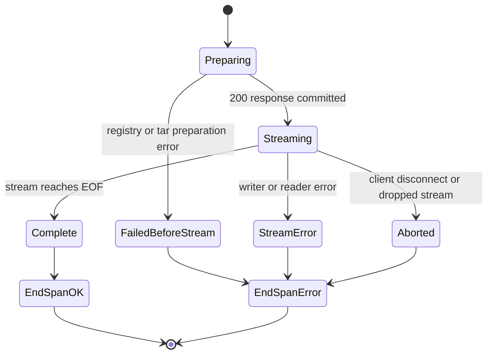

# OpenTelemetry

The service emits OpenTelemetry spans so a full copy-to-registry-to-archive execution can be followed as one trace.

## Trace hierarchy

## Distributed context

Inbound `traceparent` headers become the parent context for the local server span. Outbound registry and token requests inject the active child span context into HTTP headers.

## Core attributes

| Attribute | Meaning |
|-----------|---------|
| `http.request.method` | HTTP method, always `GET` for download routes |
| `http.route` | Low-cardinality route template |
| `url.path` | Request path |
| `url.template` | Low-cardinality upstream registry URL template |
| `http.response.status_code` | Response code for client and registry HTTP spans |
| `http.request.resend_count` | Registry retry after auth challenge |
| `client.address` | Effective client address |
| `server.address` | Local server host |
| `registry.name` | Registry display name |
| `registry.url` | Registry V2 API URL |
| `registry.target.source` | `environment` or `request_url` |
| `registry.auth.type` | Non-secret upstream auth type: `none`, `basic`, or `bearer` |
| `registry.client_auth.mode` | `off`, `optional`, or `required` |
| `registry.client_auth.credentials_present` | Whether Basic credentials were present in the client request |
| `registry.client_auth.credentials_used` | Whether client credentials were forwarded upstream |
| `container.image.name` | Resolved image name |
| `container.image.tag` | Requested image tag |
| `container.image.id` | Config digest |
| `oci.manifest.digest` | Selected manifest digest |
| `oci.layer.digest` | Layer digest |
| `oci.layer.compressed_size` | Compressed layer size |
| `oci.layer.decompressed_size` | Prepared layer tar size |
| `http.response.body.size` | Bytes streamed to the client |
| `error.type` | Stable error class or status code |

## Span completion outcomes

This prevents successful traces from appearing unfinished and marks aborted transfers as errors.
