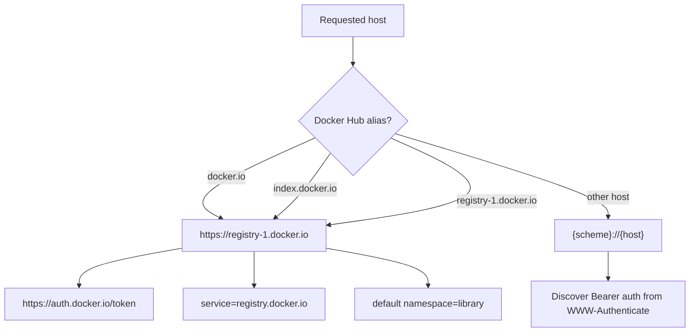
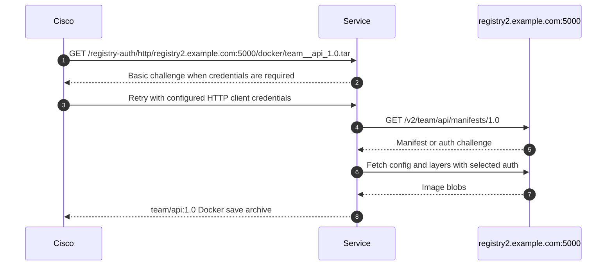

# Registry Support

The service supports Docker Registry HTTP API V2-compatible registries. Registry choice can be static through environment variables or dynamic through the request URL.

## Registry behavior

| Registry | Route host | Auth behavior | Namespace behavior |
|----------|------------|---------------|--------------------|
| Docker Hub | `docker.io`, `index.docker.io`, or `registry-1.docker.io` | Uses `https://auth.docker.io/token` and service `registry.docker.io` | Single-component images default to `library/` |
| GHCR | `ghcr.io` | Uses registry Bearer challenge discovery | Repository path must include owner/package |
| Enterprise registry | `registry2.example.com` or `registry2.example.com:5000` | Anonymous, Basic, or Bearer challenge depending on registry | No default namespace unless configured |
| IP registry | `10.10.20.30:5000` | Same as enterprise registry | No default namespace unless configured |

## Docker Hub alias handling



## GHCR path encoding

GHCR image paths include the owner and package name:

```text
ghcr.io/my-org/private-image:latest
```

The route filename encodes repository slashes as double underscores:

```text
my-org__private-image_latest.tar
```

Nested package paths follow the same rule:

```text
ghcr.io/my-org/platform/private-image:2026.06
my-org__platform__private-image_2026.06.tar
```

## Enterprise registry flow



## Image architecture

When the source image is a manifest list or OCI index, the service selects the `linux/amd64` payload image for the Docker save archive. The passthrough service container itself can be published as a multi-arch OCI image for `linux/amd64` and `linux/arm64`.
