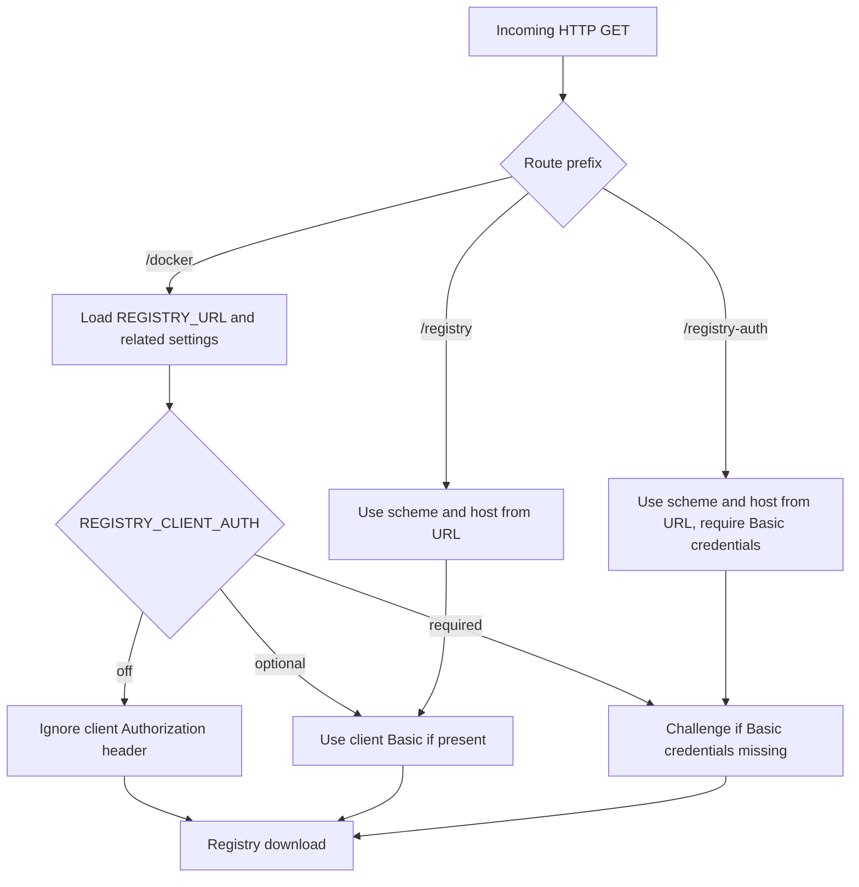

# Routes and Filenames

All download endpoints end with `/docker/{filename}`. The filename encodes the image path and tag, while the route decides where registry settings and credentials come from.

## Route matrix

| Route | Registry source | Credential source | Typical use |
|-------|-----------------|-------------------|-------------|
| `/docker/{filename}` | Environment | Environment or optional Cisco/client Basic auth | One default registry configured by the passthrough operator |
| `/registry/{scheme}/{host}/docker/{filename}` | Request URL | Environment or optional Cisco/client Basic auth | Client chooses registry; credentials are static or not required |
| `/registry-auth/{scheme}/{host}/docker/{filename}` | Request URL | Required Cisco/client Basic auth | Client chooses registry and identity per request |

## Route decision flow



## Filename format

```text
{image}_{tag}.tar
{namespace}_{image}_{tag}.tar
{path__to__image}_{tag}.tar
```

Parsing rules:

- The filename must end in `.tar`.
- The final underscore separates image path from tag.
- A single underscore preserves the historical `namespace_image` shorthand.
- Double underscores become repository path separators.
- Docker Hub defaults single-component images to `library/`.
- Non-Docker Hub registries do not add a namespace unless `REGISTRY_DEFAULT_NAMESPACE` is set.
- Tags containing underscores cannot be represented unambiguously.

## Filename examples

| Filename | Parsed image |
|----------|--------------|
| `nginx_latest.tar` | `library/nginx:latest` on Docker Hub |
| `library_nginx_1.25.tar` | `library/nginx:1.25` |
| `myrepo_myimage_v1.0.tar` | `myrepo/myimage:v1.0` |
| `team__platform__api_2026.06.tar` | `team/platform/api:2026.06` |
| `cisco-open__docker-http-passthrough_latest.tar` | `cisco-open/docker-http-passthrough:latest` |

## URL examples

```text
copy http://10.20.30.40:8080/docker/nginx_latest.tar flash:nginx.tar
copy http://10.20.30.40:8080/registry/https/ghcr.io/docker/cisco-open__docker-http-passthrough_latest.tar flash:passthrough.tar
copy http://10.20.30.40:8080/registry-auth/http/registry2.example.com:5000/docker/team__platform__api_2026.06.tar flash:api.tar
```

If a client cannot parse `:` inside the registry host path segment, percent-encode the port separator:

```text
registry2.example.com%3A5000
```
