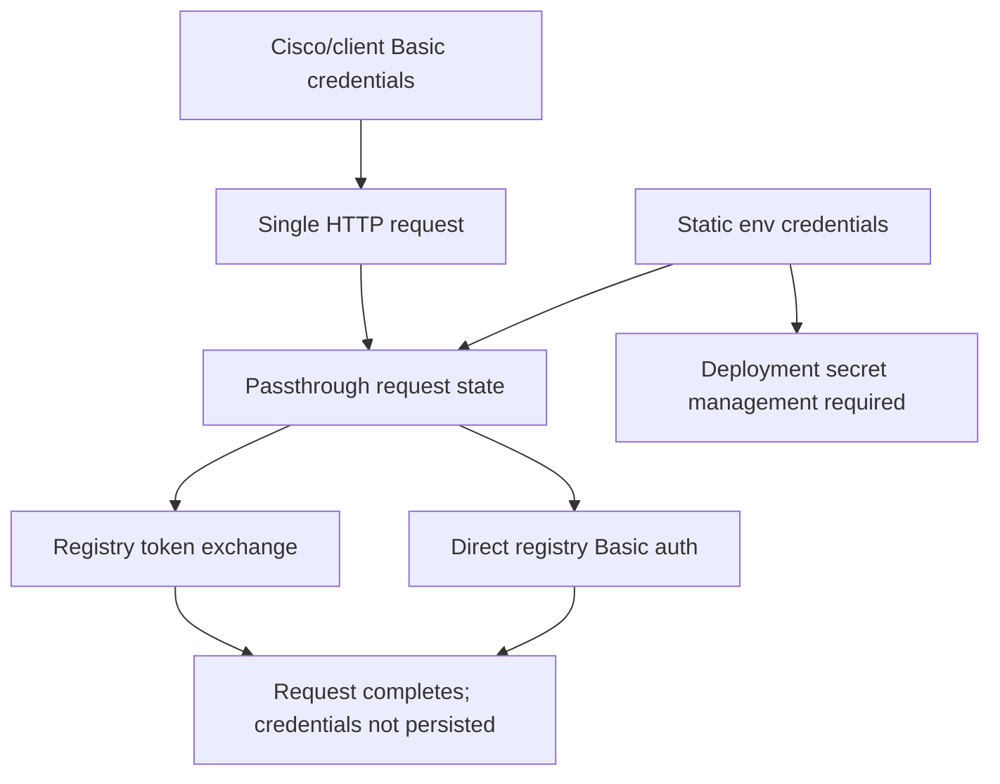
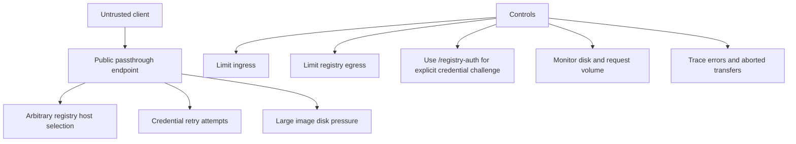

# Security

The service is a neutral conduit only when configured to be one. Production deployments should carefully control registry credential sources, network reachability, and logging.

## Credential handling model

## Production recommendations

- Use `/registry-auth/...` when the client must choose the registry and identity.
- Leave static registry credentials unset when operating as a neutral conduit.
- Store static credentials in deployment secret managers, not in images or committed files.
- Prefer short-lived or least-privilege registry tokens.
- Remove Cisco `ip http client username/password` after temporary transfers.
- Restrict egress from the passthrough service to approved registries.
- Restrict ingress to trusted Cisco/client networks.
- Enable TLS in front of the service when credentials cross untrusted networks.
- Avoid logging secrets; only non-secret auth type indicators should appear in traces.
- Rotate tokens exposed in terminal transcripts or device configs.

## Threat model overview

## Sensitive values

Treat these as sensitive:

- `REGISTRY_PASSWORD`
- `REGISTRY_BEARER_TOKEN`
- `REGISTRY_TOKEN`
- Cisco `ip http client password`
- GHCR package-readable tokens
- Docker Hub access tokens
- Enterprise registry robot tokens

Do not encode credentials in filenames or request paths.
