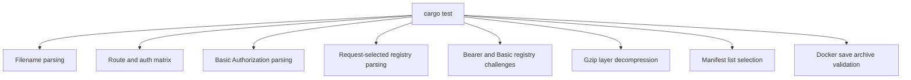
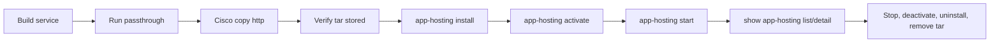

# Validation

Validation should cover local code checks, registry behavior, Cisco copy workflows, app-hosting activation, and documentation rendering.

## Automated test coverage



## Release-readiness commands

```bash
cargo fmt --check
cargo test --locked --all-targets --all-features
cargo clippy --locked --all-targets --all-features -- -D warnings
cargo test --release --locked --all-targets --all-features
git diff --check
docker compose config --quiet
docker buildx bake --print image-all
docker buildx bake image-local
```

## Cisco app-hosting validation matrix

| Registry | Route | Credentials | Expected result |
|----------|-------|-------------|-----------------|
| Docker Hub public | `/docker/{filename}` | Anonymous | Copy succeeds; app installs and reaches `RUNNING` |
| Local registry public | `/registry/http/{host}/docker/{filename}` | Anonymous | Copy succeeds; app installs and reaches `RUNNING` |
| Docker Hub private | `/docker/{filename}` | Static or Cisco client Basic | Copy succeeds; app installs and reaches `RUNNING` |
| Local private registry | `/registry-auth/http/{host}/docker/{filename}` | Cisco client Basic | Copy succeeds; app installs and reaches `RUNNING` |
| GHCR public | `/registry/https/ghcr.io/docker/{filename}` | Anonymous | Copy succeeds; app installs and reaches `RUNNING` |
| GHCR authenticated path | `/registry-auth/https/ghcr.io/docker/{filename}` | Cisco client Basic | Copy succeeds for package-readable credentials |

## Manual validation flow



## Documentation validation

For the dynamic site:

- Open `http://127.0.0.1:8088/#topology`
- Verify topology and authentication toggles
- Verify generated copy URLs wrap without horizontal overflow
- Check browser console errors

For the Zensical documentation:

```bash
zensical serve
zensical build
```

The Mermaid diagrams should render from fenced `mermaid` code blocks.
